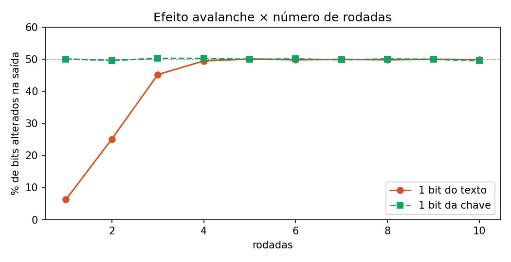
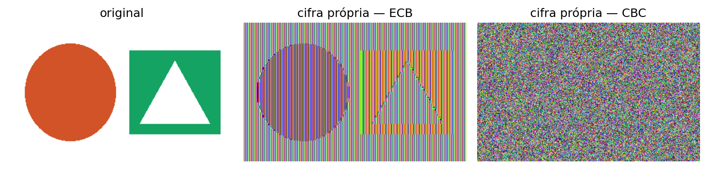

# Cifra SPN própria + análise de ataques

Projeto acadêmico da disciplina **Técnicas Avançadas de Criptografia** (CESAR School, 2026). Uma cifra simétrica própria é implementada do zero, atacada por força bruta, ataque diferencial e ataque estatístico, escondida em imagens por esteganografia e monitorada por um detector de anomalias com IA.

> ⚠️ **Uso educacional.** A cifra serve para aprender e medir. Não use para proteger dados reais: em produção, use AES-256-GCM.

## Resultado em uma frase

**Seguro no laboratório, não para produção.** A cifra resistiu à força bruta (128 bits) e ao ataque estatístico (CBC indistinguível do AES), mas uma senha de dicionário caiu em 1,9 s e a S-box é mais fraca que a do AES.

| Teste | Resultado |
| --- | --- |
| Efeito avalanche (6 rodadas) | 49,8% dos bits mudam; ideal a partir de 4 rodadas |
| Matriz SAC | média 0,50 (ideal 0,5) |
| DDT máxima da S-box | 12/256 (AES: 4/256) |
| Força bruta | ~57 mil chaves/s em Python; 128 bits é inviável |
| Dicionário sobre a senha | "recife2026" quebrada em 43 tentativas (1,9 s) |
| Entropia do cifrado (CBC) | 7,999 bits/byte; qui-quadrado aprovado (p = 0,08) |
| ECB | 92% dos blocos repetidos; reprovado |
| IA (Isolation Forest) | 100% dos ataques detectados; F1 0,95 por usuário |





## Como a cifra funciona

- **Estrutura:** rede de substituição e permutação (SPN), bloco de 64 bits, 6 rodadas (configurável de 1 a 10)
- **Cada rodada:** XOR com a subchave → S-box de 8 bits → camada P (transposição 8×8 de bits)
- **Chave dinâmica:** senha + salt aleatório por mensagem → PBKDF2-HMAC-SHA256 (100 mil iterações) → chave de 32, 64 ou 128 bits; subchaves Kᵣ = SHA-256(chave ‖ r)
- **Modos:** CBC com IV aleatório (oficial) e ECB (só para demonstrar o vazamento)
- **Integridade:** HMAC-SHA256 sobre salt, IV e cifrado (encrypt-then-MAC)
- **Pacote:** `salt(16) | IV(8) | cifrado | tag(32)`

## Arquitetura

| Camada | Arquivo | O que faz |
| --- | --- | --- |
| Entrada | `corpus.py` | Gera mensagens de chat sintéticas em pt-BR |
| Criptografia | `cipher.py` | A cifra própria, PBKDF2, CBC/ECB e HMAC |
| Ataques | `ataques.py` | Força bruta, dicionário, diferencial (avalanche, SAC, DDT) e estatístico |
| Esteganografia | `stego.py` | LSB em PNG, sequencial ou embaralhado; teste qui-quadrado de Westfeld |
| Big Data | `eventos.py` | ~50 mil eventos (reais + simulados + ataques injetados) em Parquet/DuckDB |
| IA | `ia.py` | Isolation Forest + regras, por IP × hora e usuário × hora |
| Dashboard | `dashboard.py` | Streamlit: alertas, laboratório da cifra, ataques e esteganografia |

## Como rodar

Requer Python 3.10 ou mais novo.

**Windows:** dê dois cliques em `rodar_projeto.bat`. Ele cria o ambiente, instala as dependências, gera os dados e abre o dashboard.

**Manual (qualquer sistema):**

```bash
python -m venv .venv
# Windows: .venv\Scripts\activate   |   Linux/macOS: source .venv/bin/activate
pip install -r requirements.txt
python eventos.py          # gera dados/eventos.parquet
python ia.py               # treina a IA e gera dados/janelas.parquet
streamlit run dashboard.py
```

Para refazer os ataques: `python ataques.py tudo` (ou `forca`, `dif`, `est`, `img`). Para a esteganografia com uma foto sua: `python stego.py caminho/da/foto.jpg`.

## Limitações

- Os ataques injetados no log são bem marcados (madrugada, país estrangeiro, centenas de eventos); num ambiente real a IA teria desempenho menor.
- Não houve criptoanálise formal; passar em testes estatísticos não prova segurança.
- O bloco de 64 bits fica sujeito a colisões após ~2³² blocos (mesmo problema do Sweet32).

## Autor

**Iago Figueirôa Soares** · Tecnólogo em Segurança da Informação, CESAR School
